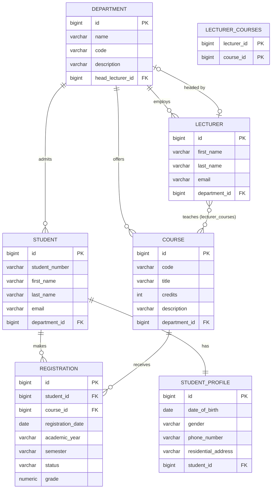
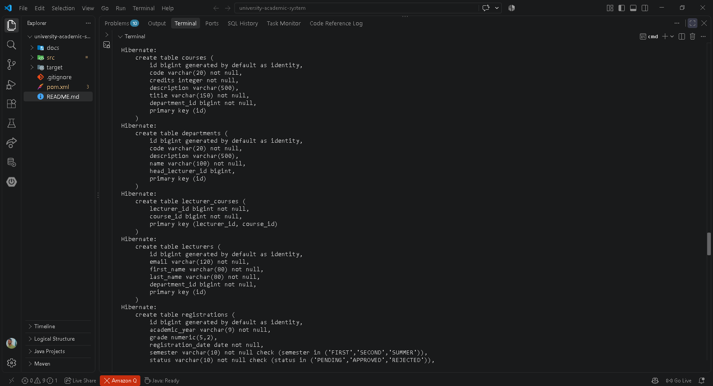
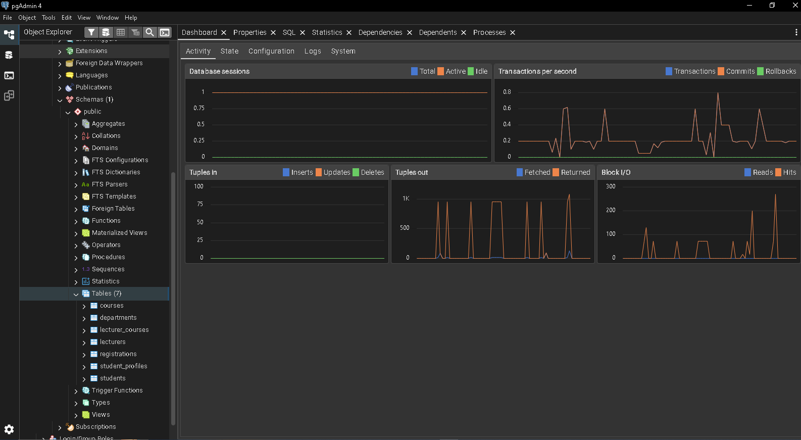
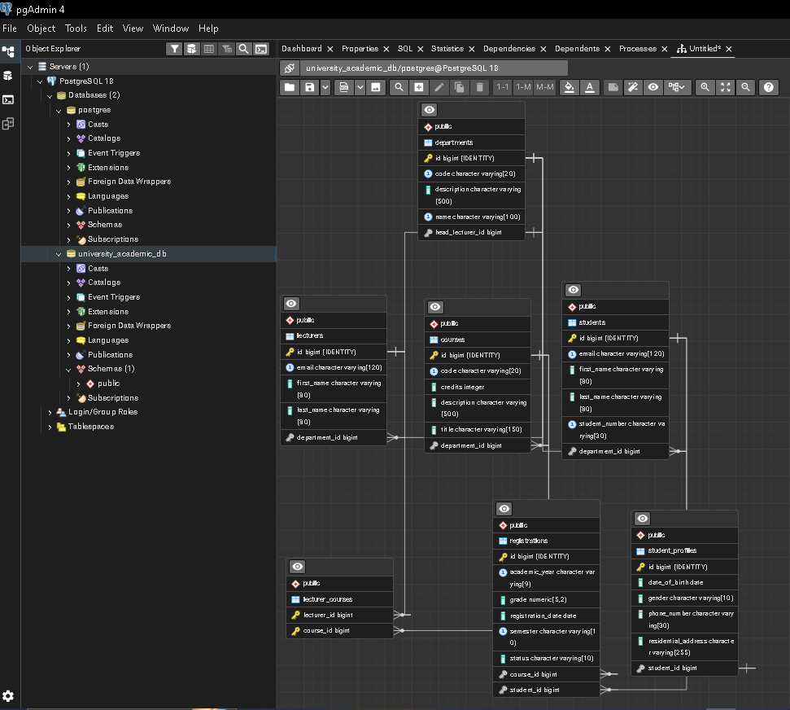
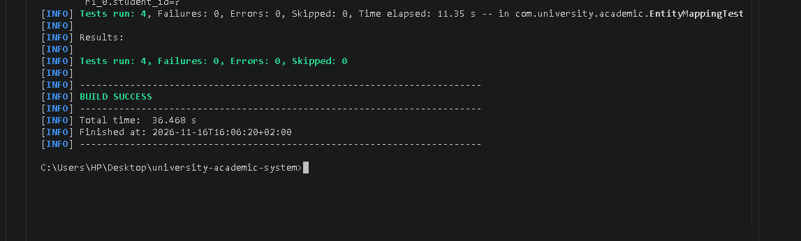
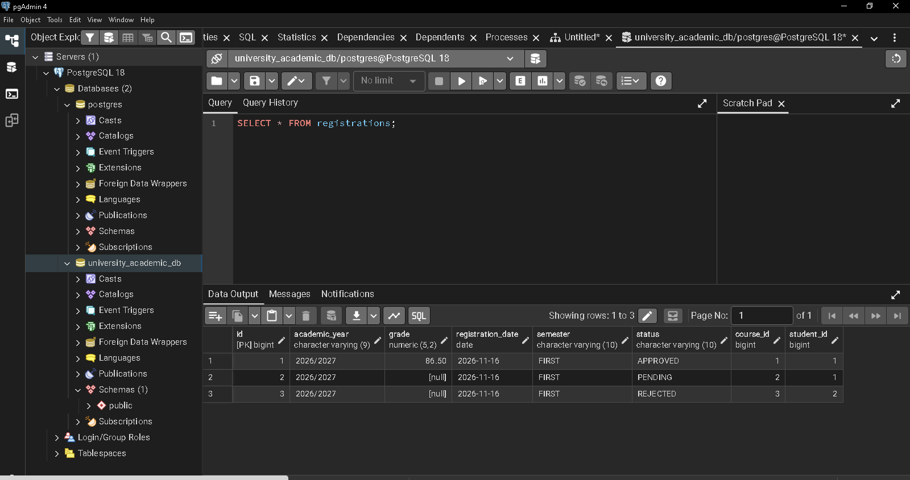

# University Course Registration and Academic Management System

Web Technology and Internet, Individual Assignment

Name: CYIZA Olivier
Registration No.: 28237

Built with Java 17, Spring Boot 3.3.5, Spring Data JPA (Hibernate), PostgreSQL and Maven. The database is called `university_academic_db`. For this stage I only did the model and repository layers, as the assignment says.

---

## 1. Understanding the problem

The university still keeps its academic records by hand, so it is hard to track students, courses, lecturers and registrations. Reading the problem statement, these are the rules I had to respect:

- A department has many courses and many lecturers, and one of those lecturers is the head of the department.
- A student belongs to one department and has exactly one profile (date of birth, gender, phone number, address). A profile belongs to only one student.
- A course belongs to one department.
- A lecturer can teach many courses and a course can have many lecturers. The assignment says this must be done without creating a separate entity.
- A student can register for many courses and a course can have many students. Each registration also needs a date, academic year, semester, status (PENDING, APPROVED or REJECTED) and grade.

## 2. Entities and attributes

I ended up with six entities.

| Entity | Attributes | Why it is an entity |
|---|---|---|
| Department | id, name, code, description, head_lecturer_id | It owns the courses, lecturers and students |
| Lecturer | id, first_name, last_name, email, department_id | A staff member with their own identity |
| Student | id, student_number, first_name, last_name, email, department_id | An admitted person with their own identity |
| StudentProfile | id, date_of_birth, gender, phone_number, residential_address, student_id | Personal details kept apart from the student, strictly one to one |
| Course | id, code, title, credits, description, department_id | What a department teaches |
| Registration | id, student_id, course_id, registration_date, academic_year, semester, status, grade | The link between a student and a course, which has data of its own |

I also made three enums: `Gender`, `Semester` and `RegistrationStatus`.

## 3. Relationships

| Relationship | Cardinality | How it is mapped | Where the foreign key is |
|---|---|---|---|
| Department employs Lecturer | One to many | `@ManyToOne` with `@JoinColumn` | `lecturers.department_id` |
| Department is headed by Lecturer | One to one | `@OneToOne` with `@JoinColumn` (unique) | `departments.head_lecturer_id` |
| Department admits Student | One to many | `@ManyToOne` with `@JoinColumn` | `students.department_id` |
| Department offers Course | One to many | `@ManyToOne` with `@JoinColumn` | `courses.department_id` |
| Student has StudentProfile | One to one | `@OneToOne` with `@JoinColumn` (unique) | `student_profiles.student_id` |
| Lecturer teaches Course | Many to many | `@ManyToMany` with `@JoinTable` | join table `lecturer_courses` |
| Student registers for Course | Many to many | Two `@ManyToOne` inside `Registration` | `registrations.student_id` and `registrations.course_id` |

Which ones need a foreign key: the first five, and the registration link through its two foreign keys.

Which one needs a join table: Lecturer and Course. The assignment says no separate entity for this, so `lecturer_courses` is only a table with two columns and no Java class.

Which one needs a join entity: Student and Course. A plain join table would not be enough, because every registration has a date, year, semester, status and grade. That is why `Registration` is a full entity.

A few choices I made along the way:

- The department head is its own one to one foreign key, separate from the "employs" relationship. This way a department has many lecturers but only one head. The column is nullable so a department can be saved before its first lecturer exists.
- `registrations` has a unique constraint on student, course, academic year and semester. A student cannot register twice for the same course in the same term, but can retake it in a later one.
- The grade is nullable because a new registration has no grade yet. It is stored as `NUMERIC(5,2)`.

## 4. ERD



## 5. Relational schema

```
departments       (id PK, name UNIQUE, code UNIQUE, description, head_lecturer_id FK -> lecturers.id UNIQUE)
lecturers         (id PK, first_name, last_name, email UNIQUE, department_id FK -> departments.id NOT NULL)
students          (id PK, student_number UNIQUE, first_name, last_name, email UNIQUE, department_id FK -> departments.id NOT NULL)
student_profiles  (id PK, date_of_birth, gender, phone_number, residential_address, student_id FK -> students.id UNIQUE NOT NULL)
courses           (id PK, code UNIQUE, title, credits, description, department_id FK -> departments.id NOT NULL)
lecturer_courses  (lecturer_id FK -> lecturers.id, course_id FK -> courses.id, PK (lecturer_id, course_id))
registrations     (id PK, student_id FK -> students.id, course_id FK -> courses.id, registration_date, academic_year,
                   semester, status, grade, UNIQUE (student_id, course_id, academic_year, semester))
```

The same schema written as SQL is in [`docs/schema.sql`](docs/schema.sql). In the project itself Hibernate creates the tables (`spring.jpa.hibernate.ddl-auto=update`).

## 6. Project structure

```
src/main/java/com/university/academic
├── UniversityAcademicApplication.java
├── model        Department, Lecturer, Student, StudentProfile, Course, Registration, Gender, Semester, RegistrationStatus
├── repository   DepartmentRepository, LecturerRepository, StudentRepository, StudentProfileRepository,
│                CourseRepository, RegistrationRepository
└── config       DataSeeder (optional sample data, profile "seed")
src/main/resources/application.properties
src/test/java/com/university/academic/EntityMappingTest.java
```

## 7. How to run it

1. Create the database in pgAdmin or psql: `CREATE DATABASE university_academic_db;`
2. Set your PostgreSQL password in PowerShell: `$env:DB_PASSWORD="your_password"`. The username defaults to `postgres`, and you can change it with `DB_USERNAME`.
3. Start the app to generate the tables: `mvn spring-boot:run`
4. If you want sample data, run it with the seed profile: `mvn spring-boot:run "-Dspring-boot.run.profiles=seed"`
5. To run the mapping tests: `mvn test`
6. In pgAdmin, refresh `university_academic_db > Schemas > public > Tables`. There should be 7 tables: `departments`, `lecturers`, `students`, `student_profiles`, `courses`, `lecturer_courses` and `registrations`.

## 8. Screenshots

All the screenshots are in `docs/screenshots/`.

Hibernate creating the tables in the console:



The 7 tables in pgAdmin:



The ERD and foreign keys in pgAdmin:



`mvn test` passing (4 tests):



Sample rows in `registrations` and `lecturer_courses` after running the seed profile:

